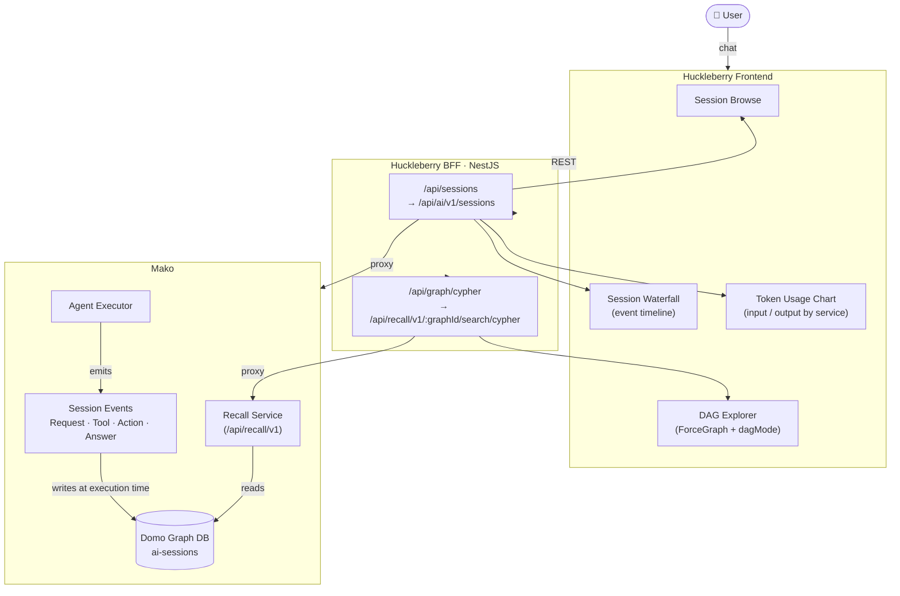

# Agent Visualizer — Hackathon Plan

"Datadog for AI agents" — turn buried session logs into an interactive look-back and comparison tool.

---

## Executive Summary

We built an end-to-end agent observability layer on top of Huckleberry's existing proxy infrastructure. Starting from the Mako session event system and Domo's graph database, we wired a live causality graph and per-session analytics view into the Huckleberry platform — no separate observability stack required.

**What shipped:**
- Live DAG visualization of agent execution pulled directly from Domo Graph DB via Cypher — nodes represent events (requests, model calls, tool use, answers), edges represent causal relationships
- Session waterfall: full chronological event timeline with expandable payloads
- Token usage breakdown by service/model call — stacked bar chart, input vs. output
- Session metadata: model, total duration, total tokens, price formula placeholder
- Graph DB query API (`/api/graph/cypher`, `/api/graph/nodes`, `/api/graph/schema`, `/api/graph/path`) — flexible passthrough for ad-hoc exploration

**What's deferred:**
- Multi-session comparison view
- Heatmap (time/token by category)
- Dollar cost estimates (Domo credit formula is undefined)

---

## System Architecture

---

## Architecture

### Event Source
Mako AI session event system. Every event carries: `sessionId`, `requestId`, `parentEventId`, `eventId`, `timestamp`.

Key types: `AIServiceRequest/Response`, `ActionStarted/Completed`, `ToolStarted/Completed`, `AssistantRequest/Response`, `McpRequest/Response`, `AgentThinkingCompleted`.

Full schema: `~/dev/postman/mako.yaml` | Types: `src/models/interfaces/sessionEvent.ts`

### Causality Model
`parentEventId` forms the primary tree. Enriched edges:
- `CHILD_OF` — parentEventId
- `TRIGGERED` — ToolStarted → ActionStarted via `toolCallId`
- `PRODUCED_BY` — AssistantResponse → ActionCompleted outputs

### Graph Storage
**Domo Graph DB** — internal graph database within the Domo platform. Mako writes events as nodes/edges at session time. Huckleberry proxies queries to the graph, consistent with its existing pattern of proxying to Domo services.

One node per event, labeled by type. Edges: `CHILD_OF`, `TRIGGERED`, `PRODUCED_BY`.

### Write Path (Mako)
Mako writes events directly to the Domo graph DB during session execution. No separate ingest step — events are graph-native at creation time. Enriched edges (`TRIGGERED`, `PRODUCED_BY`) computed at write time.

### Read Path (Huckleberry)
Huckleberry server exposes a thin query API — flexible Cypher passthrough for per-session graph queries. The session analytics view issues a bounded Cypher query (`MATCH (s:Session {localId: $sessionId})-[r*1..5]-(m) RETURN s, r, m`) and falls back to a client-side graph built from the flat events array when the graph DB returns empty.

### Server
All API endpoints are implemented in **NestJS** (`huckleberry-server`), not the ViteExpress `server.js`. Vite dev server proxies `/api/*` to the BFF on port 3000.

### Timeline Collapse
Show only `Completed` events (carries `durationMs` + output). Drop `Started` noise.

---

## Endpoints

### Sessions (proxied to Mako)
| Route | Client |
|-------|--------|
| `POST /api/sessions/search` | `AgentSessionService.getSessions()` |
| `GET /api/sessions/:id` | `AgentSessionService.getSession()` |
| `GET /api/sessions/:id/events` | `AgentSessionService.getSessionEvents()` |
| `POST /api/sessions/search/all-sessions` | All-user session search |

### Graph (proxied to Domo Graph DB)
| Route | Purpose | Status |
|-------|---------|--------|
| `POST /api/graph/cypher` | Flexible Cypher passthrough — session DAG and ad-hoc queries | ✅ Built |
| `POST /api/graph/nodes` | Node lookup by label/property | ✅ Built |
| `GET /api/graph/schema` | Graph schema introspection | ✅ Built |
| `POST /api/graph/path` | Shortest-path between nodes | ✅ Built |

> **Note:** The original plan specified `GET /api/graph/:sessionId` (canned Cypher, server-side). We implemented `POST /api/graph/cypher` (flexible passthrough) instead — the frontend constructs the session query and the server proxies it without parsing intent.

### Deferred
| Route | Purpose |
|-------|---------|
| `POST /api/compare` | Aggregation across multiple session IDs | ❌ Not built |

---

## Views

### Built
1. **Session Browse** — sessions list on Agent Detail page, sorted by recency, refreshes after each new chat message
2. **Session Waterfall** — full chronological event timeline, expandable event payloads, `Completed` events only
3. **DAG Explorer** — `ForceGraph` component with top-down DAG layout and directional arrows; queries Domo Graph DB via Cypher on session select; falls back to client-side `buildSessionGraph` when graph is empty
4. **Token Usage** — stacked bar chart per model call, input tokens (lighter) vs. output tokens (solid), color-coded by service; total token count + model tag displayed above chart

### Deferred
5. **Session Comparison** — multi-session aggregate (tokens by service, duration breakdown, action frequency, error rates) — stub only
6. **Heatmap** — time/token breakdown by category — not started

### Token / Cost Data
Source: `AIServiceResponseEvent.serviceResponse.modelProviderUsage` → `inputTokens`, `outputTokens`, `totalTokens`. Displays raw counts. Price estimate is a placeholder (Domo credit formula not yet defined).

---

## DAG Node Taxonomy

| Category | Color | Maps To |
|----------|-------|---------|
| User Prompt | Blue | `AssistantRequestEvent` |
| Plan/Think | Purple | `AgentThinkingCompleted`, `PLANNING` service |
| Get Context | Green | `dataset_query_action`, `dataset_lookup_action`, `dataset_schema_by_id_action`, `dataset_text_to_sql_action`, `vector_db_query_action`, `kb_query_action`, `fileset_query_action`, `search_action`, `google_query_action`, `firecrawl_action` |
| Use Context | Orange | `chart_builder_action`, `page_builder_action`, `html_generation_action`, `javascript_generation_action`, `code_engine_*`, `card_action`, `create_data_app_action`, `design_app_spec_action` |
| Model Call | Teal | `AIServiceResponseEvent` (TEXT_GENERATION, TOOL_CALLING, TEXT_TO_SQL) |
| Answer | Gold | `AssistantResponseEvent` |
| Other | Grey | Catch-all |

> **Implementation note:** Node coloring by taxonomy is defined in the plan but not yet wired into `ForceGraph` — nodes currently use a single color scheme from the Ontology explorer. This is the most visible gap between design spec and current UI.

---

## Presentation Outline

### 1. The Problem (1 min)
- Agents fail silently: wrong answer, wrong tool, wrong data source, no visibility into why
- Today you get a response — you don't see the work
- Domo has the data (Mako writes everything to the graph); nobody surfaces it

### 2. The Demo (5 min)
Walk a real session end-to-end:

1. **Start a session** — ask the agent a data question in Huckleberry
2. **Session list** — session appears immediately after first reply; click to open
3. **Waterfall** — show the full execution timeline: request → model calls → tool calls → answer; expand a tool call payload
4. **Token chart** — highlight which service consumed the most tokens; point out input vs. output split
5. **DAG view** — switch to the graph tab; show the causality graph queried live from Domo Graph DB; click a node to inspect

### 3. Architecture in 60 Seconds (1 min)
- Mako writes session events to Domo Graph DB natively — no extra infra
- Huckleberry BFF proxies Cypher queries — same pattern as every other Domo API call
- Frontend visualizes: ForceGraph for DAG, Recharts for tokens, custom waterfall for timeline

### 4. What's Next (1 min)
- **Node taxonomy coloring** — color-code DAG nodes by event category (already spec'd above)
- **Multi-session comparison** — same token/duration/error metrics across N sessions side-by-side
- **Cost estimates** — once Domo credit formula is defined, wire it in
- **Heatmap** — time and token cost by category across a session or agent history

### 5. Why This Matters (30 sec)
- Every Domo customer running agents will want this
- The infra is already there — Mako writes it, the graph DB stores it, we just read it
- This is the monitoring layer that makes agents trustable in production

---

## Team & Schedule

**Team:** 2 devs (A = backend/data, B = frontend/viz) + 1 designer

### Dev A — Data & Backend
| Day | Deliverable | Status |
|-----|-------------|--------|
| 1 | Graph schema, Mako write integration, graph query API | ✅ |
| 2 | Edge enrichment (TRIGGERED, PRODUCED_BY), Cypher passthrough | ✅ |
| 3 | `/api/compare` endpoint | ❌ Deferred |
| 4-5 | Pagination, perf tuning, demo data | Partial |

### Dev B — Frontend
| Day | Deliverable | Status |
|-----|-------------|--------|
| 1 | Session browse, agent detail scaffold | ✅ |
| 2 | Session waterfall + token chart | ✅ |
| 3 | DAG Explorer wired to graph API | ✅ |
| 4-5 | Comparison view, polish | ❌ Deferred |

### Designer
| Day | Deliverable | Status |
|-----|-------------|--------|
| 1 | Node taxonomy visuals | Spec'd, not wired |
| 2 | DAG node/edge styling, detail panel | Partial |
| 3 | Comparison dashboard, heatmap | ❌ Deferred |
| 4-5 | Polish, presentation deck | In progress |

---

## Existing Infrastructure

- `ForceGraph` — `src/pages/platform/Ontology/GraphExploration/ForceGraph.tsx` — reused for DAG, extended with `dagMode` top-down layout and directional arrows
- `SessionWaterfall` — `src/pages/platform/Agents/AgentDetail/SessionWaterfall/`
- `SessionOverview` — `src/pages/platform/Agents/AgentDetail/SessionOverview/`
- `SessionAnalytics` — orchestrator: fetches events + Cypher graph in parallel, passes to the active tab
- `src/utils/sessionGraph.ts` — client-side fallback: builds GraphData from flat event array
- `src/services/agentSession.ts` — session/event API client
- `src/services/graph.ts` — graph API client (Cypher, nodes, schema, path)
- `@xyflow/react` + `@dagrejs/dagre` — installed (used in `Ontology/ModelCanvas`); available if DAG view needs migration to React Flow
